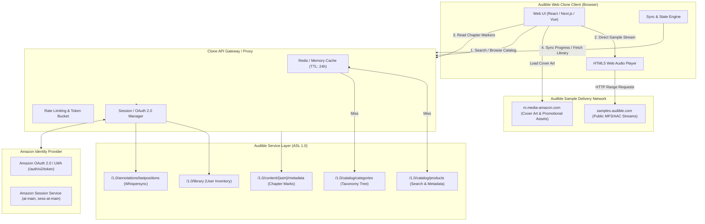
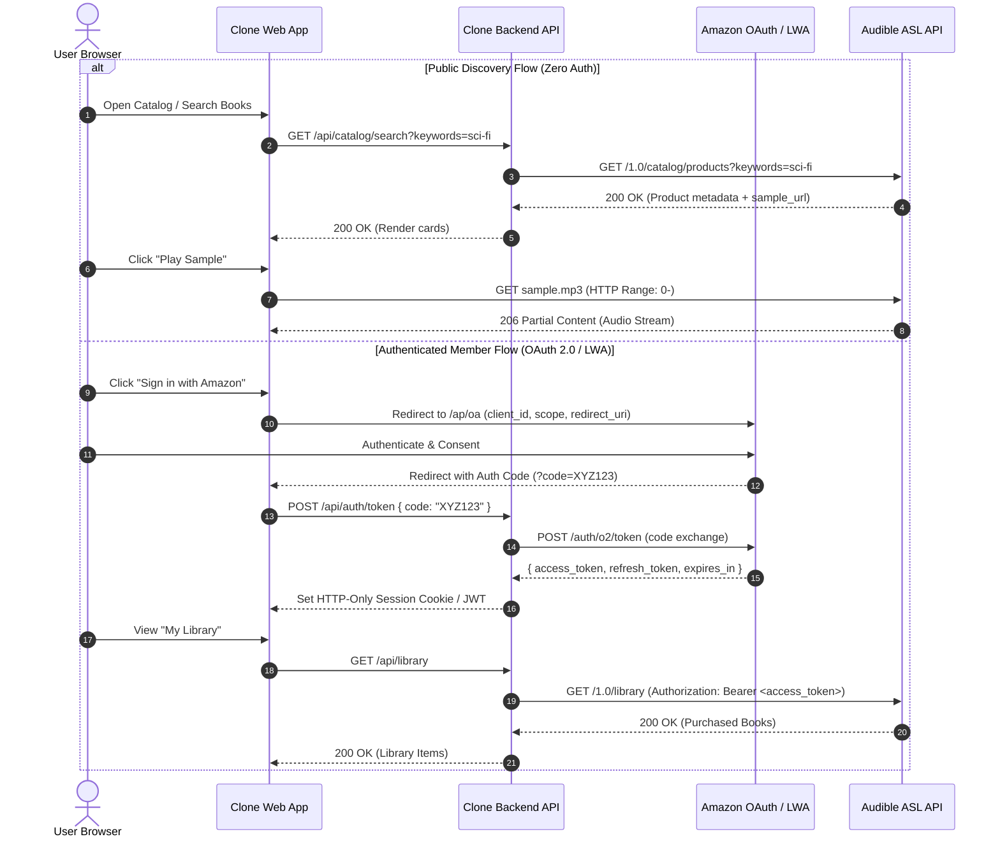

# Amazon Audible Web API Architecture & Network Endpoints Specification

> **Document Version:** 1.0.0  
> **Target Platform:** Audible Service Layer (ASL 1.0) & Web Clone Implementation  
> **Status:** Production Specification  
> **Scope:** Public Catalog, Search, Product Metadata, Chapter Timelines, Sample Audio CDN Streaming, User Library, Whispersync Playback Progress, and Authentication Architecture.

---

## 1. Executive Summary & Architecture Topology

The Amazon Audible web ecosystem relies on a hybrid architecture combining the **Audible Service Layer (ASL REST API)**, Amazon's **Login with Amazon (LWA) OAuth 2.0** identity provider, and **Amazon CloudFront Content Delivery Networks (CDNs)**.

For an **Audible Web Clone**, the application is structured into two main operational layers:
1. **Public Catalog & Streaming Layer (Zero-Auth / Public Mode):** Enables unauthenticated users to search the entire audiobook catalog, inspect deep metadata, view category taxonomies, and play unencrypted audio samples directly in the web browser.
2. **Authenticated Member & Playback Layer:** Requires authenticated sessions (via OAuth 2.0 Bearer tokens or Amazon web session cookies) to manage personal libraries, retrieve purchase histories, and synchronize millisecond-accurate listening progress (Whispersync) across devices.



---

## 2. Regional Base URLs & Marketplace Directory

Audible operates localized market endpoints with dedicated top-level domains. All localized domains host identical REST API route structures under the `/1.0/` path prefix.

| Marketplace Code | Region / Country | Audible Storefront URL | ASL API Base URL | Sample Audio CDN Host |
| :--- | :--- | :--- | :--- | :--- |
| `US` | United States | `https://www.audible.com` | `https://api.audible.com` | `https://samples.audible.com` |
| `UK` | United Kingdom | `https://www.audible.co.uk` | `https://api.audible.co.uk` | `https://samples.audible.co.uk` |
| `DE` | Germany | `https://www.audible.de` | `https://api.audible.de` | `https://samples.audible.de` |
| `FR` | France | `https://www.audible.fr` | `https://api.audible.fr` | `https://samples.audible.fr` |
| `IN` | India | `https://www.audible.in` | `https://api.audible.in` | `https://samples.audible.in` |
| `CA` | Canada | `https://www.audible.ca` | `https://api.audible.ca` | `https://samples.audible.ca` |
| `AU` | Australia | `https://www.audible.com.au` | `https://api.audible.com.au` | `https://samples.audible.com.au` |
| `JP` | Japan | `https://www.audible.co.jp` | `https://api.audible.co.jp` | `https://samples.audible.co.jp` |
| `IT` | Italy | `https://www.audible.it` | `https://api.audible.it` | `https://samples.audible.it` |
| `ES` | Spain | `https://www.audible.es` | `https://api.audible.es` | `https://samples.audible.es` |

> [!NOTE]
> For the Web Clone architecture, standardizing on `https://api.audible.com` (US) provides the broadest international catalog coverage, while localized instances can be targeted dynamically using a marketplace header or query selector.

---

## 3. Authentication Architecture & Protocol Flows

Audible supports multiple tiers of authentication depending on client capability:
1. **Public Access Mode (Unauthenticated):** Zero credentials required for catalog search, category exploration, metadata retrieval, and public sample playback.
2. **Web Cookie Session (Web Browser Client):** Amazon SSO cookies issued on `audible.com` domain.
3. **Login with Amazon (OAuth 2.0 / OpenID Connect):** Standard token-based authorization using Bearer access tokens.
4. **Audible Device Protocol (ADP Signing):** Used by mobile and native clients using RSA-SHA256 signature headers.

### 3.1 Authentication Sequence Diagram



### 3.2 Key Web Session Cookies
When interacting with Audible web storefronts, authentication state is maintained across several key cookies:

| Cookie Name | Scope | Purpose |
| :--- | :--- | :--- |
| `at-main` | `.audible.com` / `.amazon.com` | Primary Amazon authentication token cookie. |
| `sess-at-main` | `.audible.com` | Session authentication token for the active browsing session. |
| `session-id` | `.audible.com` | Unique 16-19 digit identifier for the shopping/browsing session. |
| `session-id-time` | `.audible.com` | Timestamp indicating session creation. |
| `ubid-main` | `.audible.com` | Universal browser identifier for telemetry and anti-abuse. |
| `x-main` | `.audible.com` | User verification cookie linking session to Amazon master account. |

### 3.3 CSRF Protection
Authenticated state-changing requests (such as updating listening position or creating bookmarks) require an anti-CSRF token in HTTP headers:
```http
anti-csrftoken-a2z: <CSRF_TOKEN_STRING>
```

---

## 4. Catalog Search & Discovery API

### 4.1 Search Products
Used to drive the search bar, filter panels, genre listings, and discovery carousels.

* **Endpoint:** `GET /1.0/catalog/products`
* **Authentication:** Not required (Public)
* **Standard Headers:**
  ```http
  User-Agent: Mozilla/5.0 (Windows NT 10.0; Win64; x64) AppleWebKit/537.36 (KHTML, like Gecko) Chrome/128.0.0.0 Safari/537.36
  Accept: application/json
  Accept-Language: en-US,en;q=0.9
  ```

#### Query Parameters

| Parameter | Type | Required | Default | Description |
| :--- | :--- | :--- | :--- | :--- |
| `keywords` | string | No | `""` | Free-text search across titles, authors, and keywords. |
| `title` | string | No | `""` | Exact or prefix matching on audiobook title. |
| `author` | string | No | `""` | Filter by author name. |
| `narrator` | string | No | `""` | Filter by narrator voice performer. |
| `category_id` | string/int | No | `""` | Category taxonomy identifier (e.g. `18571951011`). |
| `num_results` | integer | No | `20` | Results per page (Maximum: `50`). |
| `page` | integer | No | `0` | 0-indexed page number. |
| `products_sort_by` | string | No | `Relevance` | Sort order: `Relevance`, `BestSellers`, `AvgRating`, `-ReleaseDate`, `RuntimeLength`, `TitleAZ`. |
| `response_groups` | string | Yes | - | Comma-separated list defining fields to include: `contributors,media,price,product_attrs,product_desc,product_extended_attrs,rating,sample,series`. |
| `image_sizes` | string | No | `500,1024` | Required thumbnail sizes in pixels. |

#### Request Example
```http
GET /1.0/catalog/products?keywords=project+hail+mary&num_results=2&page=0&products_sort_by=Relevance&response_groups=contributors,media,price,product_attrs,product_desc,rating,sample,series HTTP/1.1
Host: api.audible.com
Accept: application/json
```

#### Response Example (`200 OK`)
```json
{
  "products": [
    {
      "asin": "B08G9PRS1K",
      "title": "Project Hail Mary",
      "subtitle": "A Novel",
      "authors": [
        {
          "asin": "B00HPZG5DC",
          "name": "Andy Weir"
        }
      ],
      "narrators": [
        {
          "name": "Ray Porter"
        }
      ],
      "publisher_name": "Audible Studios",
      "release_date": "2021-05-04",
      "issue_date": "2021-05-04",
      "runtime_length_min": 970,
      "format_type": "unabridged",
      "language": "english",
      "publisher_summary": "<p>Ryland Grace is the sole survivor on a desperate, last-chance mission—and if he fails, humanity and the earth itself will perish.</p><p>Except that right now, he doesn't know that. He can't even remember his own name, let alone the nature of his assignment or how to complete it.</p>",
      "product_images": {
        "500": "https://m.media-amazon.com/images/I/91r4p2UvYwL._SL500_.jpg",
        "1024": "https://m.media-amazon.com/images/I/91r4p2UvYwL._SL1024_.jpg"
      },
      "rating": {
        "overall_distribution": {
          "average_rating": 4.9,
          "display_average_rating": "4.9",
          "num_five_star_ratings": 182400,
          "num_four_star_ratings": 11200,
          "num_three_star_ratings": 2100,
          "num_two_star_ratings": 650,
          "num_one_star_ratings": 510,
          "total_ratings": 196860
        },
        "performance_distribution": {
          "average_rating": 4.95,
          "total_ratings": 194120
        },
        "story_distribution": {
          "average_rating": 4.88,
          "total_ratings": 193850
        }
      },
      "sample_url": "https://samples.audible.com/bk/audi/008272/sample.mp3",
      "price": {
        "list_price": {
          "amount": 29.99,
          "currency_code": "USD"
        },
        "lowest_price": {
          "amount": 14.95,
          "currency_code": "USD"
        }
      },
      "series": []
    }
  ],
  "total_results": 1,
  "response_groups": [
    "contributors",
    "media",
    "price",
    "product_attrs",
    "product_desc",
    "rating",
    "sample",
    "series"
  ]
}
```

---

## 5. Audiobook Detailed Metadata API

### 5.1 Get Product Details by ASIN
Provides deep metadata to populate the single product detail page (PDP), including complete author biographies, series placement, narrative reviews, and cover assets.

* **Endpoint:** `GET /1.0/catalog/products/{asin}`
* **Authentication:** Not required (Public)
* **Standard Headers:**
  ```http
  Accept: application/json
  User-Agent: AudibleClone/1.0
  ```

#### Query Parameters
* `response_groups`: Comma-separated list.
  * Recommended: `contributors,media,price,product_attrs,product_desc,product_extended_attrs,product_plan_details,rating,sample,series,reviews`
* `image_sizes`: `500,1024,2400`

#### Request Example
```http
GET /1.0/catalog/products/B017V4IMVQ?response_groups=contributors,media,price,product_attrs,product_desc,rating,sample,series&image_sizes=500,1024 HTTP/1.1
Host: api.audible.com
Accept: application/json
```

#### Response Example (`200 OK`)
```json
{
  "product": {
    "asin": "B017V4IMVQ",
    "title": "Born a Crime",
    "subtitle": "Stories from a South African Childhood",
    "authors": [
      {
        "asin": "B01J209D3E",
        "name": "Trevor Noah"
      }
    ],
    "narrators": [
      {
        "name": "Trevor Noah"
      }
    ],
    "publisher_name": "Audible Studios",
    "release_date": "2016-11-15",
    "issue_date": "2016-11-15",
    "runtime_length_min": 524,
    "format_type": "unabridged",
    "language": "english",
    "publisher_summary": "<p>Trevor Noah's unlikely path from apartheid South Africa to the desk of <i>The Daily Show</i> began with a criminal act: his birth.</p>",
    "product_images": {
      "500": "https://m.media-amazon.com/images/I/81A+gJ1v12L._SL500_.jpg",
      "1024": "https://m.media-amazon.com/images/I/81A+gJ1v12L._SL1024_.jpg"
    },
    "rating": {
      "overall_distribution": {
        "average_rating": 4.9,
        "total_ratings": 164200
      }
    },
    "sample_url": "https://samples.audible.com/bk/adbl/030278/sample.mp3",
    "series": [],
    "is_in_wishlist": false,
    "available_codecs": [
      "aac",
      "mp3"
    ]
  }
}
```

---

## 6. Chapters & Structural Content Metadata API

### 6.1 Get Chapter Information
Retrieves exact timestamp boundaries for track titles, sections, prologue, and chapters. Used to render the chapter navigation drawer, current chapter indicator, and seek markers on the audio scrubber.

* **Endpoint:** `GET /1.0/content/{asin}/metadata`
* **Authentication:** Recommended (Session/OAuth Bearer or Public Fallback)
* **Headers:**
  ```http
  Accept: application/json
  Authorization: Bearer <ACCESS_TOKEN>  [Optional for sample chapters]
  ```

#### Query Parameters
* `response_groups`: `chapter_info,content_reference`

#### Request Example
```http
GET /1.0/content/B08G9PRS1K/metadata?response_groups=chapter_info,content_reference HTTP/1.1
Host: api.audible.com
Accept: application/json
```

#### Response Example (`200 OK`)
```json
{
  "content_metadata": {
    "asin": "B08G9PRS1K",
    "content_reference": {
      "acr": "bk_audi_008272",
      "asin": "B08G9PRS1K",
      "codec": "aac",
      "format": "Enhanced",
      "version": "1.0"
    },
    "chapter_info": {
      "is_accurate": true,
      "brand_intro_duration_ms": 3120,
      "brand_outro_duration_ms": 4200,
      "runtime_length_ms": 58214000,
      "runtime_length_sec": 58214,
      "chapters": [
        {
          "title": "Opening Credits",
          "start_offset_ms": 0,
          "start_offset_sec": 0,
          "length_ms": 32000
        },
        {
          "title": "Chapter 1",
          "start_offset_ms": 32000,
          "start_offset_sec": 32,
          "length_ms": 1945000
        },
        {
          "title": "Chapter 2",
          "start_offset_ms": 1977000,
          "start_offset_sec": 1977,
          "length_ms": 2104000
        },
        {
          "title": "Chapter 3",
          "start_offset_ms": 4081000,
          "start_offset_sec": 4081,
          "length_ms": 2351000
        },
        {
          "title": "Closing Credits",
          "start_offset_ms": 58180000,
          "start_offset_sec": 58180,
          "length_ms": 34000
        }
      ]
    }
  }
}
```

---

## 7. Sample Audio Streaming Mechanics (Web Player)

### 7.1 Delivery Infrastructure
Unlike full audiobooks—which use Amazon DRM-encrypted containers (`.aax` / `.aaxc`) or encrypted HLS/DASH streams requiring license keys—**Audible audio samples are 100% unencrypted public audio streams**.

* **Protocols:** Direct HTTP / HTTPS
* **Format:** MPEG-1 Audio Layer III (`.mp3`) or Advanced Audio Coding (`.m4a` / AAC-LC)
* **Audio Specs:** 64 kbps to 128 kbps, 44.1 kHz, Stereo/Mono
* **CDN Endpoint Structure:**
  ```text
  https://samples.audible.com/{brand_code}/{publisher_code}/{numeric_id}/sample.mp3
  ```
  *Example:* `https://samples.audible.com/bk/audi/008272/sample.mp3`

### 7.2 HTTP Byte-Range Streaming
The audio player initiates playback using standard HTTP Byte-Range requests (`RFC 7233`), allowing instant scrub and seek without buffering the full audio file:

#### 1. Initial Probe Request
```http
GET /bk/audi/008272/sample.mp3 HTTP/1.1
Host: samples.audible.com
Range: bytes=0-
User-Agent: Mozilla/5.0
```

#### 2. CDN Partial Response
```http
HTTP/1.1 206 Partial Content
Date: Sun, 18 Oct 2026 06:22:00 GMT
Content-Type: audio/mpeg
Content-Length: 4892410
Content-Range: bytes 0-4892409/4892410
Accept-Ranges: bytes
Cache-Control: max-age=31536000, public
ETag: "9b3c4a1e948c27d8e4123"
```

### 7.3 Web Player Implementation Pattern (HTML5 / Web Audio API)
In an Audible Web Clone, you can wire the `sample_url` directly into an HTML5 `<audio>` element or standard audio library:

```typescript
// Sample Player Implementation
class AudibleSamplePlayer {
  private audio: HTMLAudioElement;

  constructor() {
    this.audio = new Audio();
    this.audio.preload = 'metadata';
    this.audio.crossOrigin = 'anonymous';

    this.audio.addEventListener('timeupdate', () => {
      const positionMs = Math.floor(this.audio.currentTime * 1000);
      this.onProgress(positionMs, this.audio.duration * 1000);
    });
  }

  public loadSample(sampleUrl: string) {
    this.audio.src = sampleUrl;
    this.audio.load();
  }

  public play() {
    return this.audio.play();
  }

  public pause() {
    this.audio.pause();
  }

  public seek(positionSeconds: number) {
    this.audio.currentTime = positionSeconds;
  }

  private onProgress(currentMs: number, totalMs: number) {
    // Dispatch to Redux / Zustand store
  }
}
```

---

## 8. Categories & Taxonomy Navigation API

### 8.1 Category Hierarchy
Returns multi-level genre trees to construct navigation dropdowns, sidebar filters, and curated browse directories.

* **Endpoint:** `GET /1.0/catalog/categories`
* **Authentication:** Not required (Public)

#### Query Parameters
* `root`: Hierarchy root node (`Genres`, `Curated`, `EditorsPicks`, `ExploreBy`). Default: `Genres`.
* `categories_num_levels`: Depth of sub-categories to return (`1`, `2`, or `3`).
* `response_groups`: `category_metadata`

#### Request Example
```http
GET /1.0/catalog/categories?root=Genres&categories_num_levels=2&response_groups=category_metadata HTTP/1.1
Host: api.audible.com
Accept: application/json
```

#### Response Example (`200 OK`)
```json
{
  "category_ladder": [
    {
      "id": "18571951011",
      "name": "Sci-Fi & Fantasy",
      "parent_id": null,
      "children": [
        {
          "id": "18571952011",
          "name": "Science Fiction",
          "parent_id": "18571951011",
          "children": [
            { "id": "18571953011", "name": "Space Opera" },
            { "id": "18571954011", "name": "Cyberpunk" },
            { "id": "18571955011", "name": "Post-Apocalyptic" }
          ]
        },
        {
          "id": "18571960011",
          "name": "Fantasy",
          "parent_id": "18571951011",
          "children": [
            { "id": "18571961011", "name": "Epic Fantasy" },
            { "id": "18571962011", "name": "Urban Fantasy" }
          ]
        }
      ]
    },
    {
      "id": "18571910011",
      "name": "Biographies & Memoirs",
      "parent_id": null,
      "children": [
        { "id": "18571911011", "name": "Historical" },
        { "id": "18571912011", "name": "True Crime" }
      ]
    }
  ]
}
```

---

## 9. Library & User Inventory API

### 9.1 Get User Library
Retrieves audiobooks owned by the authenticated user, complete with purchase timestamps, download status, and attached product metadata.

* **Endpoint:** `GET /1.0/library`
* **Authentication:** Required (`Authorization: Bearer <ACCESS_TOKEN>` or Amazon session cookies)

#### Query Parameters

| Parameter | Type | Required | Default | Description |
| :--- | :--- | :--- | :--- | :--- |
| `num_results` | integer | No | `50` | Maximum items to return (Max: `1000`). |
| `page` | integer | No | `0` | 0-indexed page number. |
| `sort_by` | string | No | `-PurchaseDate` | Sort order: `-PurchaseDate`, `Title`, `Author`. |
| `purchased_after` | string | No | `""` | ISO 8601 timestamp filter (e.g. `2024-01-01T00:00:00Z`). |
| `response_groups` | string | No | `media` | `contributors,media,product_attrs,product_desc,rating,sample,series` |

#### Request Example
```http
GET /1.0/library?num_results=20&page=0&sort_by=-PurchaseDate&response_groups=contributors,media,product_attrs,sample HTTP/1.1
Host: api.audible.com
Authorization: Bearer Atna|EwIC...
Accept: application/json
```

#### Response Example (`200 OK`)
```json
{
  "items": [
    {
      "asin": "B08G9PRS1K",
      "purchase_date": "2024-03-12T14:22:15Z",
      "status": "Available",
      "origin_type": "AudiblePurchase",
      "is_downloaded": false,
      "product": {
        "asin": "B08G9PRS1K",
        "title": "Project Hail Mary",
        "authors": [
          { "name": "Andy Weir" }
        ],
        "narrators": [
          { "name": "Ray Porter" }
        ],
        "runtime_length_min": 970,
        "sample_url": "https://samples.audible.com/bk/audi/008272/sample.mp3",
        "product_images": {
          "500": "https://m.media-amazon.com/images/I/91r4p2UvYwL._SL500_.jpg"
        }
      }
    }
  ],
  "total_results": 1,
  "page": 0,
  "num_results": 20
}
```

---

## 10. Whispersync Listening Progress & Annotations API

Audible synchronizes the user's active listening position across devices using millisecond-accurate timestamps.

### 10.1 Get Last Heard Position
Fetches the saved progress for one or more books.

* **Endpoint:** `GET /1.0/annotations/lastpositions`
* **Authentication:** Required
* **Query Parameters:**
  * `asins`: Comma-separated list of ASINs (e.g. `B08G9PRS1K,B017V4IMVQ`)

#### Request Example
```http
GET /1.0/annotations/lastpositions?asins=B08G9PRS1K HTTP/1.1
Host: api.audible.com
Authorization: Bearer Atna|EwIC...
Accept: application/json
```

#### Response Example (`200 OK`)
```json
{
  "last_positions": [
    {
      "asin": "B08G9PRS1K",
      "position_ms": 1420500,
      "chapter_index": 2,
      "last_updated": "2026-10-18T05:30:15Z",
      "device_type": "AudibleWebClone",
      "device_id": "browser-client-8812"
    }
  ]
}
```

### 10.2 Update Listening Progress (Whispersync Push)
Triggered periodically (e.g. every 10–30 seconds during active playback and immediately upon pause/route change).

* **Endpoint:** `PUT /1.0/annotations/lastpositions`
* **Authentication:** Required
* **Headers:**
  ```http
  Content-Type: application/json
  Authorization: Bearer Atna|EwIC...
  ```

#### Request Payload
```json
{
  "asin": "B08G9PRS1K",
  "position_ms": 1445200,
  "chapter_index": 2,
  "device_id": "browser-client-8812",
  "timestamp": "2026-10-18T06:22:45Z"
}
```

#### Response (`204 No Content` or `200 OK`)
```json
{
  "status": "SUCCESS",
  "asin": "B08G9PRS1K",
  "updated_position_ms": 1445200
}
```

### 10.3 User Bookmarks, Clips & Notes
Enables saving user-created bookmarks and timestamp notes.

* **Endpoint:** `GET /1.0/annotations/bookmarks?asin={asin}`
* **Endpoint (Create):** `POST /1.0/annotations/bookmarks`

#### Create Bookmark Request Payload
```json
{
  "asin": "B08G9PRS1K",
  "position_ms": 2105400,
  "title": "Rocky reveals the xenonite formula",
  "note": "Crucial plot turn for chapter 4 analysis",
  "created_at": "2026-10-18T06:25:00Z"
}
```

---

## 11. Production Implementation Guidelines for Audible Web Clone

### 11.1 Backend Proxy & Caching Topology
To protect client security, avoid CORS issues, and prevent rate limits against upstream Audible endpoints:
1. **Catalog Cache (Redis / In-Memory):** Cache `GET /1.0/catalog/products` and `GET /1.0/catalog/categories` with a TTL of **24 hours**. Product metadata changes infrequently.
2. **Proxying Sample Audio:** The client can stream directly from `samples.audible.com` because the CDN supports cross-origin requests (`Access-Control-Allow-Origin: *`) and Range headers (`Accept-Ranges: bytes`).
3. **Whispersync Debouncing:** On the frontend audio player, debounce progress synchronization calls:
   - On Play: Fetch latest `last_positions`.
   - In-flight Playback: Transmit `PUT /annotations/lastpositions` every **15 seconds**.
   - On Pause/Unload: Immediately flush the current position.

### 11.2 Error Handling & Status Codes
| HTTP Status Code | Meaning | Clone Frontend Behavior |
| :--- | :--- | :--- |
| `200 OK` | Successful query | Render content. |
| `206 Partial Content` | Successful range audio request | Audio player continues stream playback. |
| `400 Bad Request` | Invalid ASIN or parameter format | Show validation error message. |
| `401 Unauthorized` | Invalid/expired session token | Redirect to Amazon OAuth login flow. |
| `404 Not Found` | ASIN not available in region | Show "Audiobook not found" placeholder. |
| `429 Too Many Requests` | Rate limit reached | Exponential backoff (1s, 2s, 4s, 8s). |
| `500 / 503` | Audible upstream service outage | Serve cached metadata with offline banner. |
